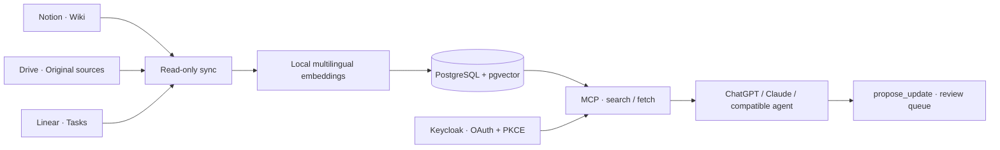

# Company Brain

Ein selbst betreibbares Unternehmensgedächtnis für MCP-fähige KI-Clients.
Notion ist das Wiki für Menschen, Google Drive speichert Originalquellen,
Linear verwaltet Aufgaben. Company Brain liest freigegebene Quellen, erzeugt
lokal mehrsprachige Embeddings und stellt Suche und vollständige Quelltexte
über einen authentifizierten MCP-Endpunkt bereit.

**Copy the architecture, bring your own data and identity.** This repository is
a standalone template: no company data, accounts, credentials or deployment
history. The local demo needs no paid AI API. Your hardware, electricity,
domain, source apps and chosen AI client can have their own costs.



## Lokal ausprobieren / Local quickstart

Voraussetzungen: Linux oder macOS, Python 3.12/3.13, [uv](https://docs.astral.sh/uv/),
Docker mit Compose v2 und ungefähr 4 GB verfügbarer Arbeitsspeicher. Die Ports
`127.0.0.1:54329`, `:8000` und `:8011` müssen frei sein. Windows: eine Linux-VM
oder WSL verwenden; diese Umgebung ist hier nicht verifiziert.

```sh
uv sync --locked --extra embeddings
uv run --extra embeddings python scripts/demo.py up
```

In einem zweiten Terminal im selben Verzeichnis:

```sh
uv run python scripts/acceptance_client.py
```

Das startet eine eigene PostgreSQL-Instanz, erstellt zufällige lokale
Zugangsdaten und einen synthetischen Benutzer und indexiert ausschließlich die
erfundenen Dokumente in `fixtures/pilot.json`. Der erste Start lädt das festgelegte
Embedding-Modell herunter. Suche und Embeddings laufen danach lokal. Der
Abnahmetest prüft echte HTTP-MCP-Aufrufe, semantische Suche, Quellenabruf und die
Zurückweisung ungültiger Zugangstokens.

The demo is an authenticated **loopback-only test**, not a public login service.
Synthetic tokens expire after one hour; restart to renew them. Private keys,
tokens, generated credentials and logs stay in ignored `runtime/demo/`; only
the public signing key is served. `Ctrl+C` stops the demo and preserves its
database volume. `uv run python scripts/demo.py stop` also stops its database.
Do not expose the demo through a tunnel or import real company data into it.

## Eigene Installation / Production

[Production setup](docs/production.md) includes:

1. A private configuration and Keycloak realm/client generator.
2. Docker Compose for the MCP service, two separate databases, Keycloak and a
   restricted Nginx gateway; no public database or admin listener.
3. Exact OAuth callbacks, PKCE S256, short-lived tokens and explicit user grants.
4. Source scopes, private token files and an optional sync job.
5. HTTPS routing, backup/restore and real-client acceptance steps.

The production stack is a starting point for an operator with their own domain
and server. It does not create DNS, expose a tunnel, register colleagues or
automatically configure their AI applications. Use a dedicated Linux VM or host;
a VM alone does not enforce network isolation. Keep host mounts and admin access
restricted and test the actual network boundary.

## Was enthalten ist / Included

| Part | Purpose |
| --- | --- |
| `src/company_brain/` | MCP server, JWT verification, collection authorization, vector store and sync |
| `src/company_brain/connectors/` | Scoped read-only Notion, Drive/Google Docs and Linear imports |
| `deploy/` | Local demo and generic production Compose, Dockerfiles, gateway template |
| `scripts/` | Demo, local MCP acceptance, private OAuth config and database bootstrap |
| `ops/database-roles.py` | Separate reader and ingest database privileges |
| `fixtures/`, `evals/` | Fictional documents and multilingual retrieval expectations |
| `tests/` | Synthetic protocol, authorization, connector and database policy tests |

## Grenzen / Boundaries

- Access is granted to **collections**, not inferred from email addresses or
  copied from every person's source permissions. Only import areas all members
  of that collection may read. See [connectors](docs/connectors.md).
- Incomplete imports and source authorization failures quarantine their scope.
  Source freshness expires after 30 minutes in production by default; choose a
  verified sync cadence shorter than that interval.
- `search` returns source links; `fetch` returns full text through pagination.
  `propose_update` queues a proposal for review. It does not publish to Notion
  or change Linear tasks. No autonomous editor, dashboard, calendar integration,
  meeting transcription or OpenViking installation is bundled.
- PDFs, images and audio/video need a separate extraction workflow. Text
  transcripts and supported Google Docs can be indexed directly.
- Local embeddings keep indexing local. Text retrieved by ChatGPT, Claude or
  another hosted client reaches that provider. Source text is untrusted context,
  not instructions for the agent.
- A passing local test does not prove the user's ChatGPT/Claude connection.
  Their client plan, permissions, OAuth setup and end-to-end behavior must be
  checked in that actual application.

## Entwicklung / Development

```sh
uv sync --locked
uv run pytest -q
uv run ruff check src tests ops scripts
```

Database integration tests are skipped unless explicitly pointed at a disposable
test database. Role tests require their own disposable **cluster** because roles
are cluster-wide; see [database roles](docs/database-roles.md). Stub embeddings
in unit tests do not establish semantic search quality; use the demo acceptance
for real local model retrieval.

MIT licensed. Dependencies and model weights retain their respective licenses.
